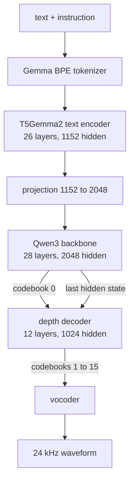

# 架构

这是从零开始基于 ggml 用 C++ 移植的 Breeze-TTS-2。参考实现使用 PyTorch 模块，而本仓库构建 ggml 计算图；数学运算力求完全一致。

## 流水线



骨干网络每前进一步产生一帧。一帧包含 16 个码本条目，对应 1920 个采样点，因此生成速度为每秒 12.5 帧。

## 文本编码器

T5Gemma2，26 层，隐藏维度 1152，4 个查询头对应 1 个 KV 头，每头维度 256，FFN 6912，激活函数为 `gelu_pytorch_tanh`。

有两个细节容易出错，二者都会生成能听懂但节奏不对的语音：

**注意力是双向的。** `T5Gemma2SelfAttention` 设置了 `is_causal=False`。滑动窗口层使用非对称的双向窗口：设 `left = (w + 1) / 2` 和 `right = w / 2 + 1`，距离为 `d = q - kv` 的 key 在 `0 <= d < left` 或 `0 < -d < right` 时可见。在这里应用因果掩码会使模型对同样的文本输出的帧数远少于应有的数量。

**RMSNorm 是 Gemma 风格。** `T5Gemma2RMSNorm` 计算 `x_norm * (1 + w)`，且权重以零为中心存储。转换器把 `+1` 预先合并进权重，因此运行时使用普通的 RMSNorm。

层在滑动窗口注意力和全局注意力之间交替，每第六层使用全局注意力，两种层使用不同的 RoPE 设置：全局层使用 theta 1e6 并带线性因子 8，滑动窗口层使用 theta 1e4。

## 骨干网络

Qwen3，28 层，隐藏维度 2048，16 个查询头对应 8 个 KV 头，每头维度 128，FFN 6144，RoPE theta 1e6，带 QK 归一化。

它读取投影后的编码器输出以及累积的音频嵌入，并通过一个 2048 到 2052 的输出头预测码本 0。Token 2051 表示语句结束；Token 2048 到 2050 在采样时被抑制。

一帧的音频嵌入是 16 个码本嵌入之和，每个都在同一张共享表中按 `codebook_index * vocab_size + token` 查找。

## 深度解码器

12 层，隐藏维度 1024，8 个查询头对应 2 个 KV 头，每头维度 128，FFN 8192，RoPE theta 5e5 并带 llama3 缩放。没有 QK 归一化。

对每一帧，它执行 15 个短的自回归步骤来填充码本 1 到 15。KV 缓存在每帧开始时清空。

位置 0 使用骨干网络的最后隐藏状态作为输入嵌入。位置 `p`（`p >= 1`）使用码本 `p - 1` 的 token，在共享嵌入表中按 `(p - 1) * vocab_size` 偏移，且该位置的 logits 使用输出头 `p - 1`。输出头权重是一个 `(15, 2051, 1024)` 张量，按码本逐个切片。

全部 15 个步骤及其采样都构建在一张计算图中，因此一帧只需一次提交和一次极小的回读，而不是 15 次往返。在该图内部，KV 缓存通过拼接增长。采样使用 top-k 加上 Gumbel 噪声，噪声由 CPU 事先从种子生成，其分布与对 top k 做 softmax 采样相同。Top-p 小于 1、强制码以及 top-k 大于 256 时，回退为每步一张图。

## 声码器

声码器是 `Qwen3TTSTokenizerV2`，从 `audio_tokenizer/` 目录加载。主检查点中的 Mimi 编解码器是无用的累赘；参考实现在推理时从不使用它，用了会产生乱码音频。

它的编码器是一个 Mimi 模型（SEANet 加 transformer 加拆分 RVQ），仅在声音克隆时需要。它的解码器则是完全不同的另一个网络：

```
codes [16, T]
  split residual quantizer      first codebook + sum of the other 15, both projected to 512
  causal conv 512 to 1024, k=3
  transformer                   8 layers, hidden 512, 16 heads, head dim 64,
                                SwiGLU, per branch layer scale, causal
                                sliding window 72, RoPE theta 1e4
  2x ConvNeXt upsample          transposed conv stride 2, then depthwise k=7,
                                LayerNorm, 1024 to 4096 to 1024, gamma scale
  causal conv 1024 to 1536, k=7
  4x decoder block              SnakeBeta, transposed conv at rates 8, 5, 4, 3,
                                then 3 residual units at dilations 1, 3, 9
  SnakeBeta, causal conv 96 to 1, k=7
  clamp to [-1, 1]
```

总上采样倍数为 `8 * 5 * 4 * 3 * 2 * 2 = 1920`，正好对应一帧。

SnakeBeta 的公式是 `x + sin(x * alpha)^2 / beta`，其中 `alpha` 和 `beta` 以对数空间存储，运行时再取指数。

因果卷积在左侧填充 `(k - 1) * dilation - (stride - 1)`，绝不在右侧填充。因果转置卷积先执行转置，再从右侧裁掉 `k - stride`，这等同于保留前 `L * stride` 个采样点。

## 无分类器引导

当 `cfg_scale != 1` 时，文本编码器、骨干网络和深度解码器都运行两次，一次使用带条件的提示，一次使用去掉指令的负向提示。Logits 按下式合并：

$$\text{logits} = \text{uncond} + s \cdot (\text{cond} - \text{uncond})$$

深度解码器在**一张图**中运行两个分支，而不是两张。每个权重只读取一次供两个分支使用，因此第二个分支的开销约为 40%，而非翻倍：`cfg_scale` 为 1 时每帧 23.5 ms，为 3 时每帧 32.3 ms。

两个分支共享一个 KV 缓存，交错方式为 `slot = pos * n_branch + branch`。这使每步写入的 token 保持连续，缓存追加只需一次复制，而 `build_branch_causal_mask` 让每个查询只在其自身分支内保持因果性，对另一分支不可见。

骨干网络把各分支作为一个批次中的行来运行。条件提示和无条件提示长度不同，无法整齐交错，因此每行保留各自的缓存、位置和掩码。这是引导剩余的开销，约为每帧 4 ms。

在 RTX 3060 上、Q8_0 模型加 Q4_K 深度解码器，端到端测量声音设计的结果：

| `cfg_scale` | 骨干网络 | 深度解码器 | 声码器 | 每帧总计 | 实时倍率 |
| --- | --- | --- | --- | --- | --- |
| 1 | 8.83 ms | 23.46 ms | 2.22 ms | 34.51 ms | 2.32x |
| 3 | 12.65 ms | 32.30 ms | 2.42 ms | 47.37 ms | 1.69x |

克隆会额外增加一次约 650 ms 的参考音频编码，这笔开销落在首段音频的等待时间上，而不影响吞吐量。

## 流式

音频按逐步增大的块刷出。第一块小到刚好让 GPU 能保持领先，通常为 1 帧（80 ms），默认每次刷出的大小增加三分之一，直到 25 帧（2 s）。在 RTX 3060 上以 Q4_K 运行的已预热服务器约 80 ms 即可产出首段音频。这一增长区间的两端均可配置，参见 [performance.md](performance.md)。

声码器在两次刷出之间通过 `VocoderStream` 保存状态，因此每次刷出只解码新帧。状态保存在持久的 GPU 张量中：每个因果卷积和深度卷积的历史、每个转置卷积的重叠尾部，以及 transformer 在其注意力窗口内的 keys 和 values。每个张量在同一条图内通过 concat 读取、用复制写回。一次性解码走的是一条用完即弃的流，由于清空后的状态等同于它之前使用的零填充，其输出不会改变。

在 Vulkan 上，一次刷出约需 8.5 ms 加上每帧 1.1 ms：1 帧为 9.1 ms，8 帧为 17.7 ms，25 帧为 40 ms。分块输出与一次性解码相比只存在舍入差异，因为 `ggml_conv_1d` 经 F16 舍入，GPU 矩阵乘法也会舍入。相对真实语音约为 40 dB 的差距。而在 CPU 上使用 F32 卷积时，各种刷出模式都能匹配到 106 dB，这证明状态本身是正确的。

分块也决定了客户端需要做什么。队列持续消耗，但每块只补充一次，因此客户端持有的音频必须多于生产一块所需的时间，而不仅仅是延迟它的第一块。生产 25 帧约需 1 s，所以即使平均速率远超播放速度，只储备 0.5 s 音频的客户端也可能断流。服务器会提前发送以覆盖大部分这种情况，参见 [server.md](server.md#queue-depth)。

## 多路流

`GenScheduler` 在一个线程上运行所有 GPU 工作。当 `--parallel` 大于 1 时，它通过 `step_jobs` 让每个活跃的 `SpeechJob` 每次前进一帧：

- **深度解码器。** 整个批次共用一张融合的图，按普通流数量、引导流数量和 top k 缓存。普通流各占一行，引导流各占两行。每条流保留自己的随机数、引导强度和温度，因此设置不同的请求可以共享一个批次。
- **骨干网络。** 一个批次，每个分支一行，各自拥有独立的缓存、位置和掩码，因为各流的长度不同。
- **声码器。** 当某条流的块填满时，在该流自己的 `VocoderStream` 上逐流运行。

共享一个批次意味着每个权重只需为每一行读取一次，这正是三路流的成本远低于单路三倍的原因。音频回调通过队列在请求自己的线程上运行，因此慢客户端只会拖慢自己。其他 GPU 工作（如编码参考声音）在帧与帧之间运行。

槽位按数量计算而非按流计算，一条引导流占用两个。当一条处于节奏控制下的流剩余音频不足 250 ms 时，新请求的提示构建与预填充最多等待 400 ms。第一块的大小根据该行数下最近帧的耗时来决定。

## 时间花在哪里

在 RTX 3060 上、Q8_0 模型加 Q4_K 深度解码器测得，按每帧音频（80 ms）计：

| 阶段 | 每帧耗时 | 占比 |
| --- | --- | --- |
| 骨干网络解码 | 8.83 ms | 26% |
| 深度解码 | 23.46 ms | 68% |
| 声码器 | 2.22 ms | 6% |

深度解码器占主导，因为它每帧要顺序执行 15 个步骤（每个码本一个），而每一步都是对单个 token 的完整 12 层前向传播。

过去它受限于调度次数：每步一次 CPU 往返，GPU 在其间闲置。如今整帧合入一张图后这一开销消失了，Vulkan 性能分析器显示每帧约 26 ms 的内核时间，其中大部分在 FFN 矩阵乘法上。剩下的开销是每帧要读取深度解码器权重 15 次，因此深度解码器的量化类型现在对速度的影响比过去更大。

## ggml 注意事项

如果你需要改动计算图代码，这些内容值得了解。

**计算图模式。** 先构建图，调用 `ggml_gallocr_alloc_graph`，然后设置输入张量数据，再计算。输入在分配之前无法写入，因为它们的底层内存尚不存在。[common.h](../include/breeze/common.h) 中的 `Graph` 会暂存待写入的输入，并在正确的时机写入。

**不支持分组卷积。** ggml 的卷积算子忽略分组参数。深度卷积核通过在 `k` 个移位视图上做移位乘法来应用，而不是展开为块对角矩阵。

**卷积核必须是 F32。** Vulkan 的 `conv_transpose_1d` 路径拒绝 F16 输入，因此转换器把所有卷积核固定为 F32，无论请求的 dtype 是什么。

**`ggml_conv_1d` 使用 F16 im2col。** 每次卷积内部的激活值都会舍入到 F16。与完整 F32 路径相比，差异约为 78 dB SNR，听不出来，所以保持现状。

**张量布局。** 卷积阶段使用 `[length, channels]`，时间在 `ne0`。transformer 阶段使用 `[hidden, tokens]`，隐藏维度在 `ne0`。二者之间做转置，对应参考实现中的 `transpose(1, 2)` 和 `permute(0, 2, 1)`。

## 源码索引

| 文件 | 内容 |
| --- | --- |
| `src/common.cpp` | 后端初始化、KV 缓存、图辅助函数、注意力、掩码 |
| `src/gguf_loader.cpp` | GGUF 加载与后端张量分配 |
| `src/config.cpp` | 元数据转配置结构体 |
| `src/tokenizer.cpp` | 带字节回退的 Gemma BPE 分词器 |
| `src/text_encoder.cpp` | T5Gemma2 编码器 |
| `src/backbone.cpp` | Qwen3 骨干网络与音频嵌入 |
| `src/depth_decoder.cpp` | 深度解码器与 llama3 RoPE 缩放 |
| `src/codec.cpp` | 声码器入口 |
| `src/codec_conv.cpp` | 因果卷积辅助函数与 SEANet 编码器 |
| `src/codec_transformer.cpp` | Mimi 编码器 transformer 与声码器 transformer |
| `src/codec_decoder.cpp` | 量化器解码、ConvNeXt、SnakeBeta、解码器块、有状态的 `VocoderStream` |
| `src/sampling.cpp` | 重复惩罚、温度、top-k、top-p |
| `src/generation.cpp` | 提示组装、`SpeechJob`、批量帧步进、分块刷出 |
| `src/scheduler.cpp` | `GenScheduler`：GPU 线程、槽位、预热 |
| `src/c_api.cpp` | C ABI 封装 |
